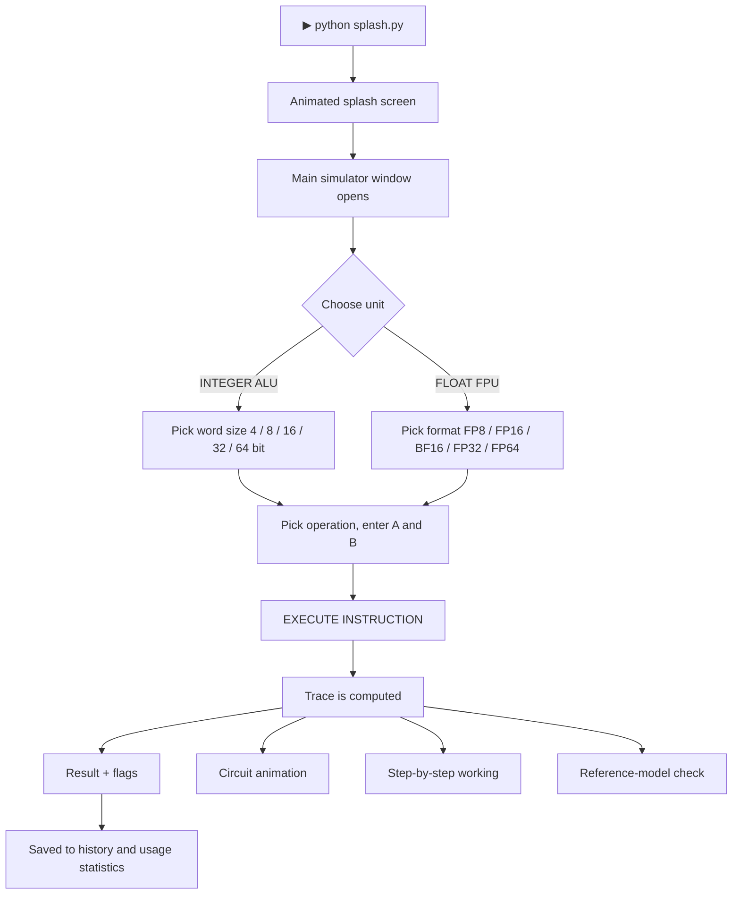

<div align="center">

# ⚙️ COA Simulator Pro

**An interactive Computer Organization & Architecture simulator that shows *how* a CPU computes, not just the answer.**


</div>

---

## 📖 What is this project?

Most programs give you `5 + 3 = 8` and hide everything in between. **COA Simulator Pro** opens the box. You pick an instruction, type two operands, and the simulator:

1. **Executes** it on a software model of a real **ALU** (integers) or **FPU** (floating point)
2. **Draws the hardware** that would perform it (adders, gates, shifters, multipliers) and **animates the signals** flowing through it
3. **Explains the working** step by step, including carries, shifts, rounding, and flags
4. **Verifies** the result against an independent reference model

It is built for learning: you can click individual bits, watch carries ripple, and see exactly why `0.1 + 0.2` is not `0.3`.

---

## 🖥️ How it works, from start to finish



1. **Launch.** `splash.py` is the entry point. It loads the simulator from `main.py`, shows a splash screen, and then reveals the main window.
2. **Choose the unit.** The *Control Unit* panel switches between the **Integer ALU** and the **Float FPU**.
3. **Enter an instruction.** Pick an operation, type operands in decimal, hex (`0xFF`), or binary (`0b1010`), or click individual bits to toggle them. The result previews live as you type.
4. **Execute.** The simulator builds a full *trace* of the instruction, then displays three things at once: the result and flags, the animated circuit, and the written working.

---

## 🔢 Integer ALU

Runs at a selectable width of **4, 8, 16, 32, or 64 bits**. All results wrap around exactly like real fixed-width hardware.

| Group | Operations | Hardware modelled |
|---|---|---|
| **Adder** | `ADD` `SUB` `INC` `DEC` `NEG` `CMP` | Ripple-carry adder; subtraction is `A + NOT(B) + 1` (two's complement) |
| **Logic** | `AND` `OR` `XOR` `NOT` `NAND` `NOR` `XNOR` | Bitwise gate array, one gate per bit |
| **Shift** | `SHL` `SHR` `SAR` `ROL` `ROR` | Barrel shifter built from $\log_2(n)$ mux stages |
| **Multiply / Divide** | `MUL` `DIV` `MOD` | Shift-and-add multiplier; restoring divider |

### How the key operations are computed

- **ADD / SUB:** A real bit-by-bit ripple-carry adder trace. The carry into every bit position is recorded so you can see it propagate. `CARRY` is the carry-out, and `OVERFLOW` is $	ext{carry-in} \oplus 	ext{carry-out}$ of the sign bit.
- **CMP:** Performs `A − B`, discards the result, and keeps only the flags, with both **signed and unsigned** comparisons shown.
- **Shifts:** The shift amount is split into bits, and each bit enables one mux stage (1, 2, 4, 8… positions). The value after every stage is shown.
- **MUL:** For each set bit of `B`, `A << i` is added to an accumulator. The full $2n$-bit product is shown, and only the low $n$ bits are kept.
- **DIV / MOD:** Restoring division. For each bit, shift the remainder, try subtracting `B`, and record the quotient bit. Division by zero is caught with a clear error.

### ALU flags

| Flag | Meaning |
|---|---|
| `ZERO` | Result is zero |
| `CARRY` | Adder carry-out (for SUB/CMP, `1` means no borrow), bit shifted out, or MUL high half non-zero |
| `SIGN` | Most significant bit of the result is set |
| `OVERFLOW` | Signed result does not fit in two's complement |

---

## 🔬 Floating-Point FPU

Supports five formats, all implemented from scratch (not using Python's built-in float), so even tiny formats like FP8 work accurately:

| Format | Layout (sign-exponent-mantissa) |
|---|---|
| **FP8** | 1-4-3 |
| **FP16** | 1-5-10 (IEEE half) |
| **BF16** | 1-8-7 (bfloat16) |
| **FP32** | 1-8-23 (IEEE single) |
| **FP64** | 1-11-52 (IEEE double) |

**Operations:** `FADD` `FSUB` `FMUL` `FDIV` `FNEG` `FABS` `FCMP`

### How floating-point is computed

1. **Decode** each operand into sign, exponent, and mantissa, and classify it (Normal, Subnormal, Zero, Infinity, NaN).
2. **Compute the exact result** using exact rational arithmetic (Python `Fraction`), so there is no hidden intermediate rounding.
3. **Round once** to the target format using **round-to-nearest-even**, the IEEE-754 default.
4. **Report** the exact value, the stored value, and the **rounding error** between them.

Special cases follow IEEE-754: `1/0 = ∞` (sets `DIV/0`), `0/0` and `∞−∞` give `NaN` (sets `INVALID`), and results too large become `∞` (sets `OVERFLOW`).

### FPU flags

| Flag | Meaning |
|---|---|
| `ZERO` | Result is `+0.0` or `−0.0` |
| `SIGN` | Sign bit of the result |
| `INVALID` | Undefined operation (`0/0`, `∞−∞`, `0×∞`, NaN in compare) |
| `DIV/0` | Finite non-zero value divided by zero |
| `OVERFLOW` | Rounded result too large, became infinity |
| `INEXACT` | Result had to be rounded |

---

## ✨ Interactive features

| Feature | What it does |
|---|---|
| 🔌 **Live circuit view** | Gate-level diagram of the chosen operation; hover and click parts to inspect |
| 🎞️ **Signal animation** | Watch data move through the circuit stage by stage (speed adjustable, can be switched off) |
| 🧮 **Bit-level view** | Click any bit of `A` or `B` to flip it; FPU bits are colour-coded into sign / exponent / mantissa |
| 📝 **Working panel** | Textbook-style explanation of the current instruction |
| 💡 **Examples menu** | One-click classic cases: signed overflow, `0 − 1` borrow, `0.1 + 0.2`, `1/3`, `0/0`, `−0.0` vs `+0.0` and more |
| 🔁 **Swap & chain** | `Swap A ↔ B` and `RESULT → A` to build multi-step calculations |
| 🎲 **Randomize** | `Ctrl+R` fills valid random operands for the current operation |
| 🕘 **History** | Every instruction is logged; click one to reload it |
| 📤 **CSV export** | Save the instruction history to a CSV file |
| 📊 **Analytics** | Usage statistics in four views: Dashboard, Radar & Rose, Heatmaps, Timeline (save as PNG) |
| ✅ **Self-checking** | Every result is cross-checked against an independent reference model, and 32-bit results are also checked against `alu_core.py` |

**Keyboard shortcuts:** `Enter` execute · `Ctrl+R` random · `Esc` clear

---

## 🚀 Run it

### Prerequisites
- **Python 3.10+** (with `tkinter` enabled—included by default in standard Windows/macOS installers; on Ubuntu/Debian, install via `sudo apt install python3-tk`).

### 1. Clone the repository
```bash
git clone https://github.com/Anand-48/COA-Simulator-Pro.git
cd COA-Simulator-Pro
```

### 2. Install the dependencies
```bash
pip install customtkinter matplotlib
```
*(Note: `matplotlib` is only needed for the analytics graphs.)*

### 3. Launch the simulator
```bash
python splash.py
```

> Start with `splash.py`, not `main.py`. It opens the splash screen and then launches the full simulator.

---

## 📁 Project structure & Documentation

| File | Role |
|---|---|
| `splash.py` | **Launcher.** Animated splash screen, analytics dashboard, and app startup |
| `main.py` | **The simulator.** ALU and FPU engines, circuit view, bit strips, working panel, and history |
| `alu_core.py` | Standalone 32-bit ALU used as an extra cross-check (optional) |
| `fpu_core.py` | Earlier standalone FPU, no longer required by the simulator |
| `COA_Simulator_Pro_Report_v2.docx` | **Project Report.** Detailed technical report with architecture diagrams and latency analysis |
| `data/` | Exported instruction logs |

---

## 👨‍💻 Team

| Name | Role |
|---|---|
| **Achyutanand Dixit** | Lead Developer |
| **Payal Gupta** | Testing & Documentation |

*MCA · Computer Organization & Architecture mini project*

---

## 📄 License

This project is open-source and available under the [MIT License](LICENSE).
